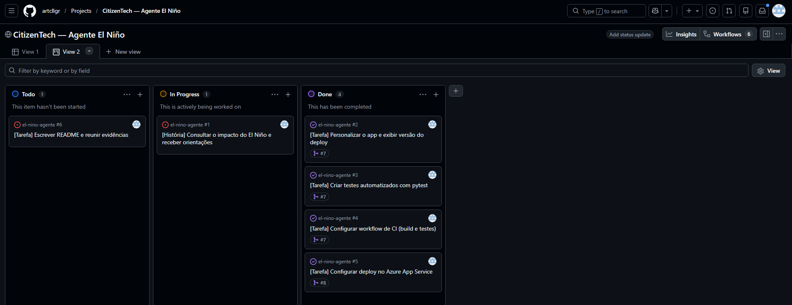
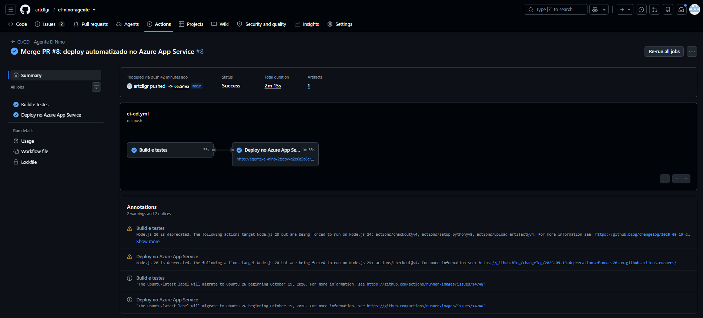
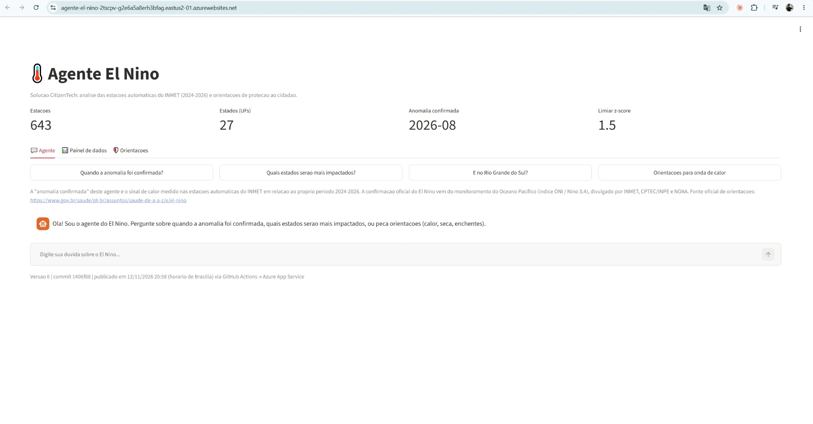
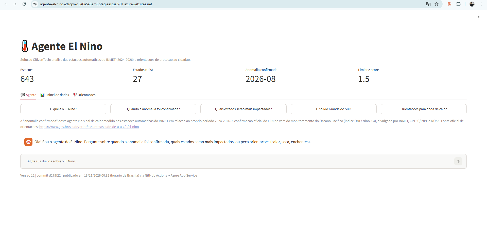

# Agente El Niño – CitizenTech

> Global Solution 02/2026 – **Cloud Solutions & Scalable Infrastructure** (FIAP – 2TSC)

**Aplicação publicada:** https://agente-el-nino-2tscpv-g2e6a5a8erh3bfag.eastus2-01.azurewebsites.net

---

## 1. Problema e proposta

**Problema.** O El Niño 2026/2027 altera chuva e temperatura no Brasil: chuvas acima da média no Sul, seca e queimadas no Norte/Nordeste e ondas de calor no Sudeste/Centro-Oeste. O cidadão não tem uma forma simples de saber **se o fenômeno já está afetando o país**, **quais estados serão mais impactados** e **o que fazer para se proteger**.

**Proposta.** Uma solução CitizenTech em duas partes:

1. **Análise de dados** (`analise_el_nino.py`): processa os arquivos anuais de **todas as estações automáticas do INMET (2024–2026)**, calcula anomalias de temperatura e chuva e identifica:
   - **quando a anomalia foi confirmada:** **agosto/2026** (sinal sustentado desde julho/2026);
   - **quais estados serão mais impactados:** ranking por índice de impacto. No período de jul–out/2026, os 5 primeiros são DF, PR, AL, AC e PE.
2. **Agente para o cidadão** (`app_el_nino.py`): app web em Streamlit com:
   - um agente que responde dúvidas ("Quando a anomalia foi confirmada?", "E no Rio Grande do Sul?", "O que é o El Niño?");
   - um painel de dados;
   - orientações de proteção para calor, seca e enchentes, com telefones de emergência e o link oficial do [Ministério da Saúde](https://www.gov.br/saude/pt-br/assuntos/saude-de-a-a-z/e/el-nino).

A "anomalia confirmada" do agente é o **sinal de calor medido nas estações do INMET** em relação ao próprio período 2024–2026. A confirmação oficial do El Niño vem do monitoramento do Oceano Pacífico (índice ONI / Niño 3.4), divulgado por INMET, CPTEC/INPE e NOAA. O app deixa esse aviso visível ao usuário.

## 2. Integrantes

| Nome | RM | Turma |
|---|---|---|
| Arthur Callegari | RM565476 | 2TSCPV |
| Lucas Zappia | RM560476 | 2TSCPV |
| Enos Cruz | RM561926 | 2TSCPV |

## 3. Origem da solução

A solução foi **criada pelo grupo como parte da Global Solution**, a partir dos dados abertos das estações automáticas do INMET e do tema El Niño 2026/2027. Para esta disciplina, o projeto foi versionado no GitHub, ganhou testes automatizados e um pipeline de CI/CD e passou a ser publicado automaticamente no **Microsoft Azure**.

## 4. Tecnologias

| Camada | Tecnologia |
|---|---|
| Linguagem | Python 3.12 |
| Análise de dados | pandas 3.1, numpy 2.5, matplotlib 3.11 |
| Aplicação web | Streamlit 1.67 |
| Testes | pytest 9.2 (27 testes) |
| Versionamento e gestão | Git, GitHub (Issues, Projects, Pull Requests) |
| CI/CD | GitHub Actions |
| Nuvem | Microsoft Azure App Service (Linux, plano F1, East US 2) |

### Estrutura do repositório

```
.github/workflows/ci-cd.yml   # pipeline de CI/CD (build, testes e deploy)
analise_el_nino.py            # processa os CSVs do INMET e gera saida/facts.json
app_el_nino.py                # aplicação Streamlit (agente, painel e orientações)
gerar_relatorio.py            # gera o relatório HTML da análise
saida/                        # resultados processados (facts.json e CSVs mensais)
scripts/verificar_reprocessamento.py  # confere se a análise é reproduzível
tests/                        # testes automatizados (pytest)
docs/evidencias/              # prints de evidência da entrega
requirements.txt              # dependências da aplicação
requirements-dev.txt          # dependências de desenvolvimento (pytest)
```

### Como executar localmente

```bash
git clone https://github.com/artcllgr/el-nino-agente.git
cd el-nino-agente
python -m venv .venv
.venv\Scripts\activate        # Windows  (Linux/Mac: source .venv/bin/activate)
pip install -r requirements-dev.txt

pytest                        # roda os 27 testes
streamlit run app_el_nino.py  # abre o app em http://localhost:8501
```

**Dados brutos.** Os CSVs anuais do INMET (pastas `2024/`, `2025/` e `2026/`, cerca de 1,4 GB) **não são versionados**, por causa do tamanho. A análise roda a partir do cache `saida/estacoes_mensal.csv`, que já está no repositório. Para reprocessar tudo desde os arquivos brutos, coloque as pastas na raiz e rode `ELNINO_FORCE=1 python analise_el_nino.py`. Os dados vêm do [portal de dados históricos do INMET](https://portal.inmet.gov.br/dadoshistoricos).

## 5. Como o GitHub foi utilizado

- **Issues:** uma **história de usuário** (#1) e **5 tarefas** (#2 a #6), cada uma com título, descrição, critérios, responsável e etiqueta (`user-story`, `tarefa`, `ci-cd`).
- **GitHub Projects:** o quadro **"CitizenTech — Agente El Niño"** tem as colunas **Todo → In Progress → Done**. Cada tarefa foi movida conforme o trabalho avançou, e o histórico de cada issue mostra essas mudanças.
- **Branches:** a `main` é a branch principal e só recebe código por Pull Request. O trabalho foi feito em branches de funcionalidade:
  - `feature/testes-ci-cd`;
  - `feature/deploy-azure`;
  - `feature/botao-o-que-e-el-nino`;
  - `docs/readme-evidencias`.
- **Commits:** mensagens descritivas no imperativo, ligadas às issues (`Refs #4`, `Closes #5`).
- **Pull Requests:** cada branch entrou na `main` por PR, com o CI rodando antes do merge:
  - [#7](https://github.com/artcllgr/el-nino-agente/pull/7): testes, CI e personalização;
  - [#8](https://github.com/artcllgr/el-nino-agente/pull/8): deploy no Azure;
  - [#9](https://github.com/artcllgr/el-nino-agente/pull/9): alteração de demonstração.
- **Segurança:** nenhuma credencial está no código. O perfil de publicação do Azure fica no secret `AZURE_WEBAPP_PUBLISH_PROFILE`, e o nome e a URL do app ficam nas variables `AZURE_WEBAPP_NAME` e `AZURE_WEBAPP_URL` do repositório. O `.gitignore` bloqueia `.env`, `*.publishsettings` e `*.pubxml`.

## 6. Workflow de CI/CD

Arquivo: [`.github/workflows/ci-cd.yml`](.github/workflows/ci-cd.yml)

### Gatilhos

| Evento | O que roda |
|---|---|
| `push` em qualquer branch | Build e testes |
| `pull_request` para a `main` | Build e testes, como validação antes do merge |
| `push` na `main`, ou seja, depois do merge | Build e testes, **e depois o Deploy no Azure** |
| `workflow_dispatch` | Execução manual pela aba Actions |

### Job 1: Build e testes

1. Faz o checkout do código e instala o Python 3.12, com cache do pip.
2. Instala as dependências (`requirements-dev.txt`).
3. Roda os **27 testes automatizados** com `pytest` e publica o relatório como artefato.
4. **Reprocessa a análise** a partir do cache e confere se o resultado é idêntico ao `facts.json` versionado (`scripts/verificar_reprocessamento.py`).
5. Faz um **smoke test**: sobe o Streamlit e consulta o health check (`/_stcore/health`).

### Job 2: Deploy no Azure App Service

- Só roda em **push na `main`** e **só se o job 1 passar** (`needs: build-e-testes`).
- Gera um `version.json` com o número da execução, o commit e a data do deploy. Esses dados aparecem no **rodapé do app**, e é assim que se prova qual versão está publicada.
- Monta um pacote com os arquivos do app e publica com a action oficial `azure/webapps-deploy@v3`, autenticada pelo secret do publish profile.
- No fim, confere se o app publicado responde ao health check. Se não responder, o job falha.

Na `main`, um push novo **não cancela** um deploy em andamento (`concurrency`).

### Configuração do Azure App Service

- **Runtime:** Python 3.12, Linux, plano **F1 (Free)**, região **East US 2**.
- **Startup command:** `python -m streamlit run app_el_nino.py --server.port 8000 --server.address 0.0.0.0 --server.headless true`
- **Variável de ambiente:** `SCM_DO_BUILD_DURING_DEPLOYMENT=true`, para o Azure instalar o `requirements.txt` no deploy.

## 7. Nuvem e link da aplicação

- **Provedor:** Microsoft Azure (Azure for Students).
- **Serviço:** Azure App Service (Web App Linux).
- **Link:** https://agente-el-nino-2tscpv-g2e6a5a8erh3bfag.eastus2-01.azurewebsites.net

O plano F1 gratuito "dorme" quando fica sem acesso. Por isso, o primeiro carregamento pode levar até 1 minuto.

## 8. Evidências

Todos os prints estão em [`docs/evidencias/`](docs/evidencias/). Eles também estão reunidos em um PDF, com legendas: [`docs/Evidencias_GS_Cloud_2TSCPV.pdf`](docs/Evidencias_GS_Cloud_2TSCPV.pdf).

### 8.1 GitHub Issues e Projects

| Evidência | Print |
|---|---|
| Lista de issues: história #1 e tarefas #2 a #6 | [02-issues-lista.png](docs/evidencias/02-issues-lista.png) |
| História #1: descrição, critérios, checklist das tarefas, responsável e status | [03-historia-1-checklist.png](docs/evidencias/03-historia-1-checklist.png) |
| Project em tabela: responsável, status e PR ligado a cada tarefa | [04-project-tabela.png](docs/evidencias/04-project-tabela.png) |
| Project em quadro: #6 em Todo, #1 em In Progress, #2 a #5 em Done | [04b-project-board.png](docs/evidencias/04b-project-board.png) |
| Evolução: #6 movida para In Progress | [15-project-6-in-progress.png](docs/evidencias/15-project-6-in-progress.png) |
| Final: todas as issues em Done | [16-project-tudo-done.png](docs/evidencias/16-project-tudo-done.png) |



### 8.2 Repositório, branches, commits e Pull Requests

| Evidência | Print |
|---|---|
| Estrutura do repositório e branch `main` | [05-repositorio-main.png](docs/evidencias/05-repositorio-main.png) |
| Histórico de commits | [06-commits.png](docs/evidencias/06-commits.png) |
| Pull Requests integrados | [07-prs-fechados.png](docs/evidencias/07-prs-fechados.png) |
| PR #8 integrado de `feature/deploy-azure` para `main` | [08-pr-8-merged.png](docs/evidencias/08-pr-8-merged.png) |

### 8.3 GitHub Actions

| Evidência | Print |
|---|---|
| Workflow: gatilhos e job de build e testes | [09a-workflow-gatilhos.png](docs/evidencias/09a-workflow-gatilhos.png) |
| Workflow: job de deploy com secret | [09b-workflow-deploy.png](docs/evidencias/09b-workflow-deploy.png) |
| Lista de execuções com sucesso | [10a-actions-execucoes.png](docs/evidencias/10a-actions-execucoes.png) |
| Execução na `main`: Build e testes, depois Deploy, os dois com sucesso | [10b-actions-build-e-deploy.png](docs/evidencias/10b-actions-build-e-deploy.png) |



### 8.4 Aplicação publicada no Azure

| Evidência | Print |
|---|---|
| App publicado (versão 6, primeiro deploy automatizado) | [01-app-publicado-versao-6.webp](docs/evidencias/01-app-publicado-versao-6.webp) |
| App Service no portal do Azure (Running, F1, East US 2) | [11-azure-app-service.png](docs/evidencias/11-azure-app-service.png) |

### 8.5 Alteração de código atualizando o ambiente

Depois do primeiro deploy, foi feita uma alteração simples: um novo botão, **"O que é o El Niño?"**, na aba do agente. Ela seguiu o fluxo completo: branch `feature/botao-o-que-e-el-nino`, PR #9 com o CI verde, merge na `main`, deploy automático e app atualizado.

| Etapa | Print |
|---|---|
| PR #9 com todas as verificações aprovadas, ainda sem deploy | [12-pr-9-ci-verde.png](docs/evidencias/12-pr-9-ci-verde.png) |
| Execução disparada pelo merge, na lista do Actions | [13a-actions-execucoes-pr9.png](docs/evidencias/13a-actions-execucoes-pr9.png) |
| Build e testes, depois Deploy, os dois com sucesso, commit `d279f22` | [13b-actions-deploy-pr9.png](docs/evidencias/13b-actions-deploy-pr9.png) |
| App atualizado: botão novo e rodapé "Versão 12, commit d279f22" | [14-app-atualizado-versao-12.png](docs/evidencias/14-app-atualizado-versao-12.png) |

| Antes: versão 6, 4 botões | Depois: versão 12, botão novo |
|---|---|
|  |  |

## 9. Limitações da análise

- A referência ("normal") é o próprio período 2024–2026. São só 3 anos, então as anomalias são **relativas a esse período**, e não a uma climatologia de 30 anos.
- A confirmação usa as estações em terra. O critério oficial do El Niño é a temperatura do Oceano Pacífico (ONI).
- O índice de impacto usa pesos fixos por região (calor e chuva no Sul, calor e seca no Norte/Nordeste). Ele indica tendência e não substitui os alertas oficiais.
- Roraima fica fora do ranking porque sua única estação não tem dados no período de impacto. O agente explica isso quando alguém pergunta sobre RR.
